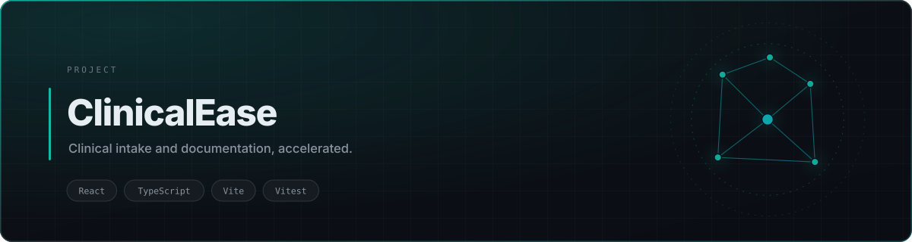

<div align="center">

<picture>
  <source media="(prefers-color-scheme: dark)" srcset="./assets/banner-dark.svg">
  <source media="(prefers-color-scheme: light)" srcset="./assets/banner-light.svg">
  
</picture>

<br>


<br><br>

<a href="#quick-start">Quick Start</a> · <a href="#features">Features</a>

</div>

## Overview

Clinical time is spent on documentation, not on patients. **ClinicalEase** targets that gap: structured intake, triage support, and documentation drafting in one surface, so the record is written as care happens instead of reconstructed afterwards.

> **Note:** this is a workflow prototype. It is not a medical device and must not be used for clinical decision-making.

## Features

| | |
|---|---|
| **Structured intake** | Typed forms keep history and presentation fields consistent |
| **Triage support** | Surfaces the information a clinician needs before the encounter |
| **Documentation drafting** | Turns encounter detail into a draft note for review |
| **Tested components** | Vitest configured for unit coverage on the UI layer |

## Stack

React · TypeScript · Vite · Tailwind CSS · shadcn/Radix · Vitest

## Quick Start

```bash
git clone https://github.com/tribetorkoz/clinical-ease.git
cd clinical-ease
npm install
npm run dev      # http://localhost:5173
npm test
```


## License

MIT
